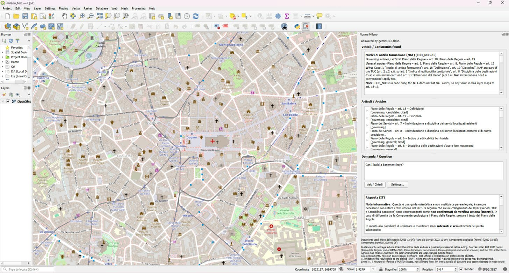

# Norme Milano: a QGIS plugin for Milan's planning rules

[](https://github.com/SaeedSabzeh/QGIS/actions/workflows/ci.yml)
[](https://plugins.qgis.org/plugins/norme_milano/)
[](https://qgis.org)
[](LICENSE)

*Clicca un punto di Milano e scopri quali norme del PGT si applicano lì, con gli articoli e una risposta in italiano o inglese.*



<sub>Map: © OpenStreetMap contributors. Constraints: Regione Lombardia geoservices.</sub>

**Quick start:** in QGIS open **Plugins → Manage and Install Plugins → Settings**, tick **Show also experimental plugins**, then search for **Norme Milano**. Until the plugin is approved, download `norme_milano-0.1.3.zip` from [Releases](https://github.com/SaeedSabzeh/QGIS/releases) and use **Install from ZIP**.

Click a point in Milan and the plugin shows which planning rules apply there:

- **Constraints found at the point**, from Regione Lombardia's live map services: the PGT zoning categories (historic cores, consolidated urban fabric, transformation and regeneration areas, services, agricultural and landscape areas), landscape sensitivity class, geological feasibility class, PGRA flood hazard and risk, Natura 2000 sites and regional parks.
- **The articles that govern each constraint**, from a hand-checked table that maps every category to its articles. Each article is labelled *governing*, *general* or *candidate*, and you can expand it to read the full text.
- **Optional answers to free-text questions** in Italian or English, from Gemini or a local Ollama model. The model answers only from the articles supplied, and any citation outside them is removed and flagged.

> **Guidance only, not legal advice.** Always check the official texts and ask a qualified professional before acting. In v1 the plugin queries the **clicked point**, not a whole parcel, so a parcel that crosses two zones can be misreported.

## Status

The plugin works in **QGIS 3.44.15 LTR** (Qt 5.15, Python 3.12). Clicks at the Duomo, Lambro and Chiaravalle return the expected findings and articles. It is written to also support QGIS 4 (Qt6), but that has not been tested yet. Phases 0–4 of the [implementation plan](docs/implementation-plan.md) are done (the constraint checklist still needs a manual check).

**Published:** version 0.1.3 is on [plugins.qgis.org](https://plugins.qgis.org/plugins/norme_milano/) as an **experimental** plugin. It passed the repository's security scan, the contact email is confirmed, and it is waiting for approval by the volunteer staff. Once approved, enable **Show also experimental plugins** in the Plugin Manager settings and search for *Norme Milano*.

0.1.3 was checked in QGIS 3.44 with a real Gemini key while Google was overloaded: the key saved to the profile settings without a master password, and the Duomo question was answered in about 28 seconds by the fallback model.

## Sources

| Document | Version | Ids |
|---|---|---|
| Piano delle Regole – Norme di attuazione | approved DCC 93 of 04/12/2025, BURL 28/01/2026 | `PR-art-1…53` |
| Piano dei Servizi – Norme di attuazione | updated after DCC 100 of 19/12/2022 | `PS-art-1…14` |
| Documento di Piano – Norme di attuazione | approved 14/10/2019, in force 05/02/2020 | `DP-art-1…8` |
| PTC Parco Agricolo Sud Milano + Allegato A | DGR 7/818 of 03/08/2000 (the later amendments of 2007 and 2009 are local changes outside Milan) | `PTC-art-1…54`, `PTC-all-A` |
| PGT geological and seismic norms | in force 05/02/2020 | `CG-…`, `CGS-…` |
| Documento di Piano – Allegato 1, landscape contents | in force 05/02/2020 (explanatory, not binding) | `DPA1-sec-…` |

The map layers are Regione Lombardia's ArcGIS services: the `tav_previsioni_b` PGT mosaic, Rete Natura 2000, PGRA 2022 and regional parks. The URLs, fields and test results are in [docs/phase0-services.md](docs/phase0-services.md).

**Known gaps:**
- **Finer zoning.** The regional mosaic treats Milan's whole consolidated urban fabric as one zone, so the plugin cannot tell whether a point is in a historic core, an ADR, an ARU or a particular tissue. It offers art. 18–23 as candidates. The exact zones are on Tav. R.02 / R.03, which need the Comune's GIS data.
- **Transformation-area sheets.** The individual sheets (PCU3, PCU4 and so on) were not found. PCU3 and PCU4 are linked to PTC art. 26 and Allegato A, and that link is marked *verify*.
- **Parco Nord Milano.** It is not in the regional parks layer.
- **Links marked `verify`.** About half of the map entries are flagged `verify` and need a person to confirm them.

See also [docs/missing-data-findings.md](docs/missing-data-findings.md).

## How it works

1. **Lookup.** The clicked point is sent to 28 map layers at once. The categories they return are mapped to articles by [`data/zone_map.yaml`](data/zone_map.yaml) and [`data/constraint_map.yaml`](data/constraint_map.yaml).
2. **Search.** The question is rewritten into Italian keywords by the LLM, and a BM25 search over all 172 records adds up to 5 more articles. Binding documents rank before explanatory ones.
3. **Answer.** The governing articles are sent in full. Other articles are trimmed to the paragraphs that best match the question. The model must return Italian and English answers with `cited_articles`, and any citation outside the supplied set is rejected. Answers may use light markdown (bold, lists), which the dock renders after escaping any HTML.
4. **Fallback.** Gemini models are tried in order (`gemini-3.8-flash`, `gemini-3.5-flash`, `gemini-3.1-flash-lite`). A busy or unresponsive model gets at most one quick retry before the next one is tried, with a 20 s timeout per request (45 s for the last model) and a 65 s total budget, so a question waits about 75 s at most. The dock shows which model is being tried.

Without an LLM provider, the plugin still shows the findings and the full article texts.

## Install in QGIS

```bash
python scripts/build_plugin.py
```

In QGIS, open **Plugins → Manage and Install Plugins → Install from ZIP** and choose `dist/norme_milano-0.1.3.zip` (`dist/norme_milano.zip` is an identical copy). The build also validates the zip against the plugins.qgis.org rules (`scripts/check_plugin_zip.py`). To ask questions, open **Plugins → Norme Milano → Settings**, choose Gemini (with a key from https://aistudio.google.com/apikey) or Ollama, and paste the key. No master password is needed: if the QGIS password store is available and a master password is already set, the key is stored encrypted there; otherwise it is stored in plain text in your QGIS profile settings (a note under the field says which). You can also set the `GEMINI_API_KEY` environment variable. On Gemini's free tier, Google may use prompts to improve its products.

For the manual test checklist, see [docs/testing-in-qgis.md](docs/testing-in-qgis.md).

## Command line

```bash
python -m core.ask 45.4642 9.1900
```

Add a question, for example `"Posso costruire un piano interrato?"`. Questions need `GEMINI_API_KEY` set, or `--provider ollama`.

## Evaluation

The set has 40 questions written from the article texts ([eval/questions.yaml](eval/questions.yaml)):

- by document: 23 Piano delle Regole, 7 Piano dei Servizi, 3 Documento di Piano, 3 PTC, 2 cross-document, and 2 "not in the corpus";
- by language: 22 Italian and 18 English;
- 9 are tied to a point.

**Retrieval** (`python eval/run_eval.py --mode retrieval`; 38 questions scored; 2 "not in the corpus" questions left out):

| Metric | Question text as keywords | Gemini's Italian keywords |
|---|---|---|
| recall@5 | 72% | **80%** |
| recall@10 | 83% | **89%** |
| MRR | 0.623 | **0.716** |
| Gold article included in the prompt sent to the model | 86% | **93%** (100% for questions with a point) |

The Italian keyword rewrite closes most of the gap on English questions: without it, English recall@5 is 65%, against 79% for Italian. A point maps about 30 articles, and these rank ahead of the search results. That guarantees the gold article reaches the prompt, but it lowers top-5 ranking, so trimming the mapped list is the next improvement.

**LLM answers** (`--mode llm`; run 05/11/2026). Gemini 3.8 and 3.5 Flash were overloaded, so 37 of the 40 answers came from the smallest fallback model, `gemini-3.1-flash-lite`, and 3 from `gemini-3.5-flash`:

| Metric | Value |
|---|---|
| Citation precision (cited articles that are gold or acceptable) | **96%** |
| Citation recall (gold articles cited) | **92%** |
| Invented citations (rejected ids) | **0%** |
| Replies that were not valid JSON | 0 |
| "Not in the corpus" questions declined, with nothing cited | 2 / 2 |
| Latency, median (with retries and fallbacks) | 27 s |

Of the 4 questions with a missed gold article, 3 had the article missing from the prompt (a retrieval miss, not the model's fault). In the other, q38, the model cited one of the two gold articles. Per-question results are in `eval/results/llm_gemini-3.8-flash_2026-11-05.jsonl`, and the summary in [eval/results/summary_llm.md](eval/results/summary_llm.md).

**Answer correctness** (`--mode judge`: an LLM scores each answer against the question's key facts, 0–2 per fact, using [eval/rubric.md](eval/rubric.md); the judge ran on `gemini-3.1-flash-lite` because of the same overload):

| Metric | Value |
|---|---|
| Mean score (key-fact points / maximum) | **75%** |
| Fully correct (every key fact scored 2) | 16 / 40 |
| "Not in the corpus" questions | 100% |
| Hallucinations flagged by the judge | 1, a **false positive** on review (see below) |

The low scores are mostly **incomplete** answers, not wrong ones. For example, q06 covers the parking location and the bicycle quota but leaves out the tree-planting rule. The one flagged hallucination (q16, radar height limits) was checked by hand: all four values in the answer (133, 134, 141 and 150 m above sea level) are in PR art. 40. The judge flagged them only because they were not in its answer key. A rerun with `gemini-3.8-flash`, for both answers and judging, is planned once Google's load allows. The summary is in [eval/results/summary_judge.md](eval/results/summary_judge.md).

**Constraint correctness**: 20 points were queried live with no layer errors. [eval/constraint_checklist.md](eval/constraint_checklist.md) still needs to be checked by hand against the official map viewers.

## Layout

```
plugin/   QGIS shell: map tool, dock panel, settings, background tasks, network adapters
core/     QGIS-free library (standard library only): services, retrieval, prompts, llm, mdlite (answer markdown), pipeline, ask CLI
data/     articles.json, documents.json, zone_map / constraint_map (.yaml sources, .json runtime)
scripts/  build_corpus.py, build_maps.py, build_plugin.py, probe_services.py
eval/     questions, rubric, constraint points, run_eval.py, results/
tests/    pytest (offline; a fake qgis package for the plugin shell)
docs/     implementation plan, Phase 0 services, missing data, testing in QGIS
```

## Development

```bash
pip install -r requirements-dev.txt
```

```bash
python -m pytest -q
```

```bash
python scripts/build_corpus.py
```

```bash
python scripts/build_maps.py
```

The source PDFs go in `data/raw/`, which is git-ignored.

## Release / publishing (manual steps for the owner)

1. Run `python -m pytest -q`, `python -m ruff check core scripts tests plugin`, `bandit -r plugin core -q` and `python scripts/build_plugin.py`. Check that `version=` in `plugin/metadata.txt` and [CHANGELOG.md](CHANGELOG.md) say what you want to release.
2. The GitHub repository is **public** (done): `metadata.txt` links to it (repository, tracker, homepage).
3. Optionally tag the release: `git tag v0.1.3 && git push origin v0.1.3`. The `release.yml` workflow builds the zip and attaches it to a GitHub pre-release.
4. Log in with your **OSGeo ID** (done).
5. For a new version, open https://plugins.qgis.org/plugins/norme_milano/ → **Add version**, upload `dist/norme_milano-<version>.zip` and tick the checklist. The plugin is **experimental** (`experimental=True`), so users must enable "Show also experimental plugins" to see it. The first version waits for approval by the staff. If the site answers with a Cloudflare 502 after Save, check the Versions tab before uploading again: the version is usually saved anyway.
6. Courtesy email to Regione Lombardia (sit_rl@regione.lombardia.it, sitpianificazione@regione.lombardia.it) about reuse terms and attribution wording: the Italian draft is in [docs/email-regione-lombardia.md](docs/email-regione-lombardia.md). Nothing has been sent.

## Licence

GPL-2.0-or-later (required by the official QGIS plugin repository). See [LICENSE](LICENSE).
