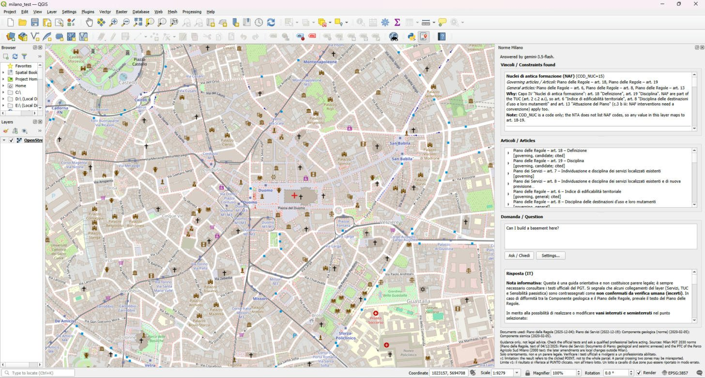

# Norme Milano: a QGIS plugin for Milan's planning rules

[](https://github.com/SaeedSabzeh/QGIS/actions/workflows/ci.yml)
[](https://plugins.qgis.org/plugins/norme_milano/)
[](https://qgis.org)
[](LICENSE)

*Clicca un punto di Milano e scopri quali norme del PGT si applicano lì, con gli articoli e una risposta in italiano o inglese.*



<sub>Map: © OpenStreetMap contributors. Constraints: Regione Lombardia geoservices.</sub>

**Quick start.** In QGIS, open **Plugins → Manage and Install Plugins**, search for
**Norme Milano**, then activate its map tool. For a local build, use **Install from ZIP** and
select `dist/norme_milano-0.1.6.zip`. [QGIS Plugin Repository](https://plugins.qgis.org/plugins/norme_milano/)

Click a point in Milan and the plugin shows which planning rules apply there:

- **Constraints found at the point**, from the Comune di Milano and Regione Lombardia: the PGT zoning categories (historic cores, consolidated urban fabric, transformation and regeneration areas, services, agricultural and landscape areas), landscape sensitivity class, geological feasibility class, PGRA flood hazard and risk, Natura 2000 sites and regional parks.
- **The articles that govern each constraint**, from a hand-checked table that maps every category to its articles. Each article is labelled *governing*, *general* or *candidate*, and you can expand it to read the full text.
- **Optional answers to free-text questions** in Italian or English, from Gemini or a local Ollama model. The model answers only from the articles supplied, and any citation outside them is removed and flagged.

> **Guidance only, not legal advice.** Always check the official texts and ask a qualified professional before acting. The results describe the clicked point. Check the full parcel and the relevant drawings before applying them to a project.

## Status

Version **0.1.6** redesigns the panel and adds the Comune's constraint maps: intervention types
(Tav. R.03), administrative, heritage and landscape constraints (Tav. R.05-R.06) and airport limits
(Tav. R.07-R.08). See the [changelog](CHANGELOG.md). Version 0.1.5 added the live Tav. R.02 zoning
and Tav. G.17 geology; its build rationale and validation points are in the
[0.1.5 release document](docs/norme-milano-0.1.5.md).

The public versions and approval status are shown in the [QGIS Plugin Repository](https://plugins.qgis.org/plugins/norme_milano/).

## Sources

| Document | Version | Ids |
|---|---|---|
| Piano delle Regole – Norme di attuazione | approved DCC 93 of 04/12/2025, BURL 28/01/2026 | `PR-art-1…53` |
| Piano dei Servizi – Norme di attuazione | updated after DCC 100 of 19/12/2022 | `PS-art-1…14` |
| Documento di Piano – Norme di attuazione | approved 14/10/2019, in force 05/02/2020 | `DP-art-1…8` |
| PTC Parco Agricolo Sud Milano + Allegato A | DGR 7/818 of 03/08/2000 (the later amendments of 2007 and 2009 are local changes outside Milan) | `PTC-art-1…54`, `PTC-all-A` |
| PGT geological and seismic norms | in force 05/02/2020 | `CG-…`, `CGS-…` |
| Documento di Piano – Allegato 1, landscape contents | in force 05/02/2020 (explanatory, not binding) | `DPA1-sec-…` |

The dock links each finding to its map service and each article to the official publication.
Article details show the version and the page range in the PDF used for the corpus.

**Coverage limits.** Where Tav. R.02 gives no single detailed category, use the official drawings.
The regional TUC layer gives broad context. Tav. R.03 morphology, individual transformation sheets,
and the Parco Nord PTC zone rules still require a source check. The plugin flags uncertain links.

## How it works

1. **Lookup.** The bundled municipal boundary is checked before contacting the Comune and Regione
   services. Municipal R.02 and G.17 supply the finer zoning, park areas and geology reference.
2. **Search.** For an optional question, Italian search terms help search the article corpus. Explicit
   document names and article references are retained even if the keyword rewrite omits them.
3. **Answer.** The model receives selected texts and the map findings, including unavailable layers.
   The dock shows excerpts that occur in the text supplied to the model and flags incomplete support.
   Review the official rules when applying a conclusion to a project.

The map findings and article texts are available with the provider set to **None**.

## Install in QGIS

```bash
python scripts/build_plugin.py
```

In QGIS, open **Plugins → Manage and Install Plugins → Install from ZIP** and choose `dist/norme_milano-0.1.5.zip` (`dist/norme_milano.zip` is an identical copy). The build also validates the zip against the plugins.qgis.org rules (`scripts/check_plugin_zip.py`). To ask questions, open **Plugins → Norme Milano → Settings**, choose Gemini (with a key from https://aistudio.google.com/apikey) or Ollama, and paste the key. No master password is needed: if the QGIS password store is available and a master password is already set, the key is stored encrypted there; otherwise it is stored in plain text in your QGIS profile settings (a note under the field says which). You can also set the `GEMINI_API_KEY` environment variable. On Gemini's free tier, Google may use prompts to improve its products.

For the manual test checklist, see [docs/testing-in-qgis.md](docs/testing-in-qgis.md).

## Command line

```bash
python -m core.ask 45.4642 9.1900
```

Add a question, for example `"Posso costruire un piano interrato?"`. Questions need `GEMINI_API_KEY` set, or `--provider ollama`.

## Evaluation

The [0.1.5 release document](docs/norme-milano-0.1.5.md) records the live geographic checks and a
replay of document retrieval on the existing question set.

The archived 6 November 2026 model run produced 38 answers, 37 with scored citations.
Its judge summary reports 17 fully correct answers and 79% of available fact points.
These figures describe that earlier model run. The retrieval replay for 0.1.5 measures
which article IDs reach the prompt.
[Stored answer evaluation](eval/results/summary_judge.md) · [Stored citation evaluation](eval/results/summary_llm.md)

## Layout

```
plugin/   QGIS shell: map tool, dock panel, settings, background tasks, network adapters
core/     QGIS-free library (standard library only): services, retrieval, prompts, llm, mdlite (answer markdown), pipeline, ask CLI
data/     articles.json, documents.json, zone_map / constraint_map (.yaml sources, .json runtime)
scripts/  build_corpus.py, build_maps.py, build_plugin.py, probe_services.py
eval/     questions, rubric, constraint points, run_eval.py, results/
tests/    pytest (offline; a fake qgis package for the plugin shell)
docs/     implementation plan, Phase 0 services, missing data, testing in QGIS
```

## Development

```bash
pip install -r requirements-dev.txt
```

```bash
python -m pytest -q
```

```bash
python scripts/build_corpus.py
```

```bash
python scripts/build_maps.py
```

The source PDFs go in `data/raw/`, which is git-ignored.

## Release / publishing

1. Build and test the ZIP, and check `version=` in `plugin/metadata.txt` and [CHANGELOG.md](CHANGELOG.md).
   Run the [release verification](docs/norme-milano-0.1.5.md#verification) on the exact package.
2. Push the matching source. A Git tag such as `v0.1.5` triggers the GitHub package workflow.
3. Use **Add version** on the existing Norme Milano listing and upload the matching versioned ZIP.
   The QGIS catalog records the security scan and approval separately.
   [Norme Milano listing](https://plugins.qgis.org/plugins/norme_milano/) · [QGIS approval process](https://plugins.qgis.org/docs/approval)

## Licence

GPL-2.0-or-later (required by the official QGIS plugin repository). See [LICENSE](LICENSE).
